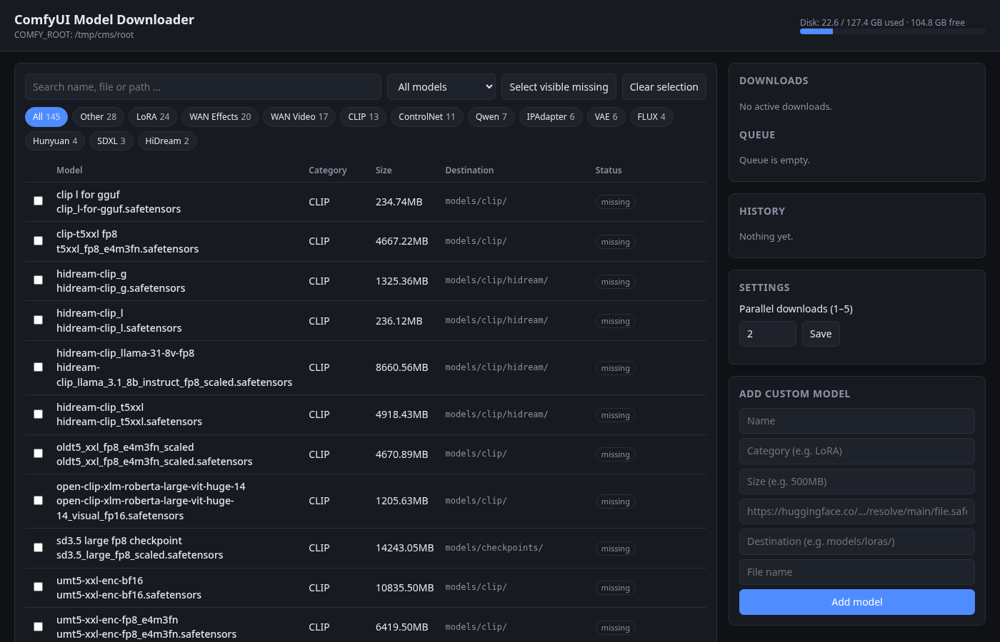

# ComfyUI Model Downloader

Flask-App zum Durchsuchen, Auswählen und Herunterladen von **145 kuratierten ComfyUI-Modellen** in **13 Kategorien**. Downloads laufen mit `wget -c` (fortsetzbar) in einer Warteschlange mit einstellbarer Parallelität.

Eine verwandte Variante läuft als Hugging-Face-Space: [MikeChandler/comfyui-model-downloader-v1.1](https://huggingface.co/spaces/MikeChandler/comfyui-model-downloader-v1.1).

## Funktionen (dieser Repo-Stand)

- Katalog in `models.json`: Name, Kategorie, Größe, Download-URL und Zielpfad unter dem ComfyUI-Root
- Prüft, welche Dateien bereits unter `COMFY_ROOT` liegen, und zeigt die Speicherbelegung
- Download-Warteschlange (`MAX_CONCURRENT_DOWNLOADS`, Standard 2, über die API auf 1–5 begrenzbar), Fortschritt, Tempo und ETA aus der wget-Ausgabe
- Abbrechen, Historie, erneutes Anstoßen (Resume durch `wget -c`)
- Eigene Modelle dauerhaft in `/app/data/user_models.json` anlegen oder wieder löschen; heruntergeladene Dateien können von der Platte entfernt werden

### Modell-Kategorien (145 Einträge in `models.json`)

| Kategorie | Anzahl | Beispiele |
|---|---|---|
| Other | 28 | Remacri, AbsoluteReality, AnimateLCM, SAM / SUPIR u. a. |
| LoRA | 24 | ACE, Catvton, FastWan, Lightx2v |
| WAN Effects | 20 | Remade-AI-Effekte (Assassin, Cakeify, …) |
| WAN Video | 17 | Wan 2.1, FusioniX, VACE, Fun-Control |
| CLIP | 13 | clip_l, t5xxl, HiDream, umt5, LLaVA |
| ControlNet | 11 | FLUX Inpainting, InstantX Union, SD1.5 Depth/Tile |
| Qwen | 7 | Qwen Image Edit, Lightning, GGUF |
| IPAdapter | 6 | SDXL, SD1.5, InstantID |
| VAE | 6 | FLUX ae, HiDream, SDXL, WAN |
| FLUX | 4 | Dev fp8, Schnell Q4, Kontext, Fill |
| Hunyuan | 4 | FramePack, Video 720p, 3D-dit-v2 |
| SDXL | 3 | RealVisXL, Realism Engine, Sketch |
| HiDream | 2 | i1 fast fp8, e1 full Q4 |

## Voraussetzungen

- Docker, oder Python 3.12 mit Flask und `wget`
- Ein ComfyUI-Verzeichnis, das nach `COMFY_ROOT` gemountet bzw. gesetzt wird

## Web-Oberfläche



`templates/index.html` ist eine einzelne Seite ohne Build-Schritt: Suche, Filter nach Kategorie und Status, Mehrfachauswahl, Download-Warteschlange mit Fortschrittsbalken, Abbrechen, Historie, Speicheranzeige, Parallelität einstellen und eigene Modelle anlegen oder entfernen.

## Start mit Docker

```bash
git clone https://github.com/Mike-Chandlerr/comfyui-model-selector.git
cd comfyui-model-selector
docker build -t comfyui-model-downloader .
docker run -d \
  --name comfyui-model-downloader \
  --restart unless-stopped \
  -p 5050:5000 \
  -v /pfad/zu/deinem/ComfyUI:/comfyui-models \
  -v /pfad/zu/appdata:/app/data \
  -e MAX_CONCURRENT_DOWNLOADS=2 \
  -e TZ=Europe/Vienna \
  comfyui-model-downloader
```

Danach: [http://localhost:5050](http://localhost:5050).

Ohne Docker:

```bash
pip install -r requirements.txt
export COMFY_ROOT=/pfad/zu/ComfyUI
python app.py
```

Die App lauscht auf `0.0.0.0` und Port `PORT` (Standard 5000).

### Umgebungsvariablen

| Variable | Standard | Bedeutung |
|---|---|---|
| `COMFY_ROOT` | `/comfyui-models` | ComfyUI-Wurzel für Downloads und Existenzprüfung |
| `MODELS_JSON` | `/app/models.json` | Pfad zum Basiskatalog |
| `USER_MODELS_JSON` | `/app/data/user_models.json` | Benutzerdefinierte Modelle |
| `DATA_DIR` | `/app/data` | Persistentes Datenverzeichnis |
| `MAX_CONCURRENT_DOWNLOADS` | `2` | Parallele Downloads |
| `PORT` | `5000` | Interner App-Port |

## API

| Methode | Endpunkt | Beschreibung |
|---|---|---|
| `GET` | `/api/models` | Katalog, vorhandene Dateien, Speicherplatz, `comfy_root` |
| `POST` | `/api/download` | Body: `{ "model_ids": ["m000", ...] }` — in die Warteschlange |
| `GET` | `/api/download/status` | Aktive Jobs, Queue, Historie |
| `POST` | `/api/download/cancel` | Body: `{ "id": "m000" }` — Abbruch |
| `POST` | `/api/models/add` | Eigenes Modell (`name`, `category`, `size`, `url`, `dest`, `filename`) |
| `POST` | `/api/models/delete` | Benutzer-Modell aus dem Katalog entfernen (nicht die Basis-Einträge) |
| `POST` | `/api/models/delete-file` | Heruntergeladene Datei von der Platte löschen |
| `GET` / `POST` | `/api/settings` | `max_concurrent` lesen oder setzen (1–5) |

Beispiel zum Hinzufügen eines eigenen Modells:

```bash
curl -X POST http://localhost:5050/api/models/add \
  -H "Content-Type: application/json" \
  -d '{
    "name": "Mein Custom LoRA",
    "category": "LoRA",
    "size": "500MB",
    "url": "https://huggingface.co/user/model/resolve/main/model.safetensors",
    "dest": "models/loras/",
    "filename": "mein_lora.safetensors"
  }'
```

## Technik

Python 3.12, Flask, wget, Docker, Vanilla-JS-Oberfläche. Lizenz: MIT (siehe `LICENSE`).

**Sicherheit:** Ziele eigener Modelle müssen innerhalb von `COMFY_ROOT` liegen (Pfade mit `../` werden abgelehnt). Die App hat keine Anmeldung – nur im eigenen Netz betreiben.

---

# ComfyUI Model Downloader

A Flask app to browse, select, and download **145 curated ComfyUI models** across **13 categories**. Downloads use `wget -c` (resumable) and a queue with configurable concurrency.

A related variant runs as a Hugging Face Space: [MikeChandler/comfyui-model-downloader-v1.1](https://huggingface.co/spaces/MikeChandler/comfyui-model-downloader-v1.1).

## Features (as in this repository)

- Catalog in `models.json`: name, category, size, download URL, and destination under the ComfyUI root
- Checks which files already exist under `COMFY_ROOT` and reports disk usage
- Download queue (`MAX_CONCURRENT_DOWNLOADS`, default 2, clampable to 1–5 via the API), with progress, speed, and ETA parsed from wget
- Cancel, history, and resume via `wget -c`
- Custom models persisted in `/app/data/user_models.json`; downloaded files can be deleted from disk

See the German section for the category table (counts taken from `models.json`).

## Requirements

- Docker, or Python 3.12 with Flask and `wget`
- A ComfyUI directory mounted or set as `COMFY_ROOT`

## Web UI

`templates/index.html` is a single page with no build step: search, category and status filters, multi-select, download queue with progress bars, cancel, history, disk usage, concurrency setting, and adding or removing custom models (see the screenshot above).

## Run with Docker

```bash
git clone https://github.com/Mike-Chandlerr/comfyui-model-selector.git
cd comfyui-model-selector
docker build -t comfyui-model-downloader .
docker run -d \
  --name comfyui-model-downloader \
  --restart unless-stopped \
  -p 5050:5000 \
  -v /path/to/your/ComfyUI:/comfyui-models \
  -v /path/to/appdata:/app/data \
  -e MAX_CONCURRENT_DOWNLOADS=2 \
  -e TZ=Europe/Vienna \
  comfyui-model-downloader
```

Then open [http://localhost:5050](http://localhost:5050).

Without Docker:

```bash
pip install -r requirements.txt
export COMFY_ROOT=/path/to/ComfyUI
python app.py
```

The app listens on `0.0.0.0` and `PORT` (default 5000). Environment variables and API routes are listed in the German section.

## Tech stack

Python 3.12, Flask, wget, Docker, vanilla JS UI. License: MIT (see `LICENSE`).

**Security:** custom model destinations must stay inside `COMFY_ROOT` (paths with `../` are rejected). The app has no authentication – run it on your own network only.

---

Michael Weidinger (Mike Chandler) – AI & Automation  
[Hugging Face](https://huggingface.co/MikeChandler) · [LinkedIn](https://www.linkedin.com/in/michael-weidinger-76a9aa270/)
